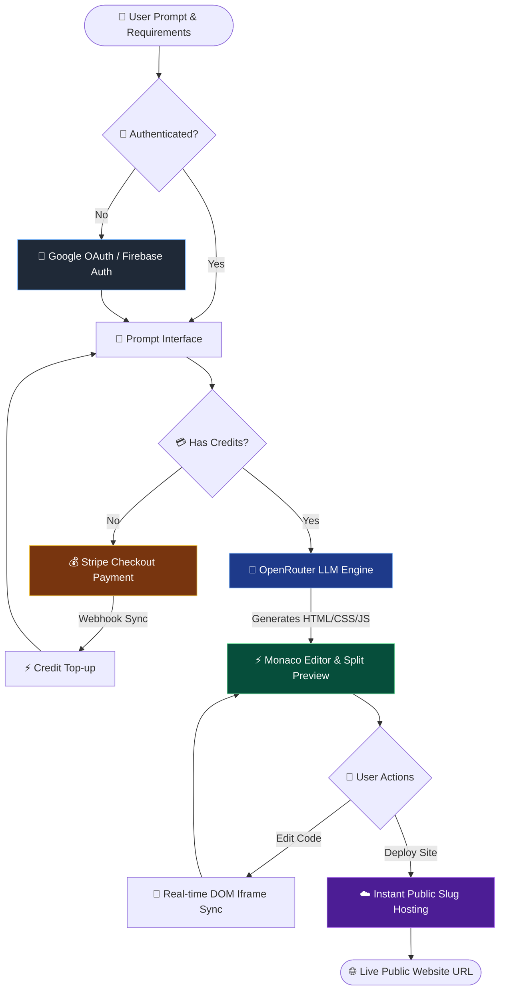

# 🚀 AI Website Builder – Prompt-to-Website SaaS Platform

[](https://react.dev/)
[](https://nodejs.org/)
[](https://expressjs.com/)
[](https://www.mongodb.com/)
[](https://stripe.com/)
[](https://openrouter.ai/)
[](https://websitebuilder-6.onrender.com/)

An intelligent, full-stack **AI Website Generator & Deployment SaaS Platform** built using **React 19**, **Node.js/Express 5**, **MongoDB**, **OpenRouter AI LLM**, **Monaco Editor**, and **Stripe Payments**.

The platform enables users to convert natural language prompts into complete, responsive, framework-free single-page websites (HTML, CSS, and JavaScript) in seconds. Features include split-screen live code editing, instant public deployment with custom slugs, token/credit-based monetization managed via Stripe Checkout and automated webhook events, and secure multi-provider authentication.

---

## 🌟 Key Features

- 🧠 **AI Prompt-to-Code Synthesis**: Specialized system prompting leveraging OpenRouter LLM architecture to generate mobile-first, business-ready HTML5, CSS3, and JavaScript code.
- ⚡ **Split-Screen Monaco IDE**: In-browser code editing powered by `@monaco-editor/react` with instant live DOM re-rendering and preview.
- 🚀 **One-Click Instant Deployment**: Publish generated websites online with unique live URLs (`/site/:slug`) for immediate public access.
- 💳 **Credit & Webhook Payment Engine**: Stripe payment gateway integration with automated webhook handlers to process top-ups and manage credit balances.
- 🔐 **Multi-Provider Session Management**: Google OAuth authentication via Firebase Auth backed by custom JWT HTTP-only cookie sessions.
- 📊 **Interactive Dashboard**: View credit balances, track generated project history, launch workspace editors, and manage deployment links.
- 🎨 **Modern Responsive UI**: Built with React 19, Tailwind CSS v4, and Framer Motion (`motion`) for smooth animations and fluid micro-interactions.

---

## 🏗️ Architecture & Workflow

WebCraft AI connects client interaction, backend orchestration, AI inference, and database/billing services:



### Detailed System Flow
1. **User Authentication**: User logs in using Google OAuth (Firebase Auth) and receives a secure JWT cookie session.
2. **Prompt & Credit Check**: Upon submitting a prompt, the backend checks `user.credits`. If insufficient, the user is directed to Stripe Checkout.
3. **AI Code Generation**: The prompt is processed via OpenRouter AI using a principal frontend architect prompt system, returning structured HTML, CSS, and JS.
4. **Live Workspace & Editing**: The project opens in Monaco Editor with live split-screen preview for real-time customization.
5. **Instant Deployment**: Clicking deploy assigns a unique slug and makes the website live on Render.

---

## 🛠️ Tech Stack

| Component | Technology | Purpose |
| :--- | :--- | :--- |
| **Frontend Framework** | [React 19](https://react.dev/) + [Vite](https://vitejs.dev/) | High-performance single page application framework & bundler |
| **State Management** | [Redux Toolkit](https://redux-toolkit.js.org/) | Centralized state management for user sessions & generated website data |
| **UI & Styling** | [Tailwind CSS v4](https://tailwindcss.com/) + [Motion](https://motion.dev/) | Modern utility-first styling and fluid micro-animations |
| **Code Editor** | [Monaco Editor](https://github.com/microsoft/monaco-editor) | In-browser split-screen IDE for real-time HTML/CSS/JS editing |
| **Backend API** | [Express 5](https://expressjs.com/) on [Node.js](https://nodejs.org/) | RESTful API server handling generation logic, routes, and auth |
| **AI Engine** | [OpenRouter API](https://openrouter.ai/) | High-level LLM prompt orchestration for production-grade code synthesis |
| **Database** | [MongoDB](https://www.mongodb.com/) + [Mongoose v9](https://mongoosejs.com/) | NoSQL database storing user accounts, credits, and website projects |
| **Payments & Billing** | [Stripe SDK](https://stripe.com/) | Credit purchasing via Stripe Checkout & raw JSON webhook automation |
| **Authentication** | [Firebase Auth](https://firebase.google.com/) + [JWT](https://jwt.io/) | Google OAuth, email login, and secure HTTP-only cookie sessions |
| **Hosting & Cloud** | [Render](https://render.com/) | Production hosting for full-stack client, backend server, and live sites |

---

## 📁 Repository Structure

```gcode
websiteBuilder/
├── client/                            # Frontend React + Vite Application
│   ├── src/
│   │   ├── components/                # UI components (Navbar, Footer, CodeEditor, etc.)
│   │   ├── pages/                     # Application pages (Home, Dashboard, Editor, Generate, Pricing, LiveSite)
│   │   ├── redux/                     # Redux slices for user & website state management
│   │   ├── hooks/                     # Custom React hooks
│   │   ├── firebase.js                # Firebase Auth SDK configuration
│   │   ├── App.jsx                    # Route definitions & global providers
│   │   └── main.jsx                   # Application entry point
│   ├── package.json                   # Client dependencies & scripts
│   └── vite.config.js                 # Vite build configuration
│
├── server/                            # Backend Express + Node.js API Server
│   ├── config/                        # Database connection & OpenRouter AI setup
│   ├── controllers/                   # Business logic (auth, website, billing, webhooks)
│   ├── middleware/                    # Auth verification middleware (`isAuth.js`)
│   ├── models/                        # Mongoose schemas (user.model.js, website.model.js)
│   ├── routes/                        # Express API routes (auth, user, website, billing)
│   ├── utils/                         # Helper utilities (extractJson.js)
│   ├── index.js                       # Express server setup & middleware pipeline
│   └── package.json                   # Server dependencies & scripts
│
└── README.md                          # Project documentation
```

---

## 🚀 Getting Started

### 1. Prerequisites
- **Node.js**: Version `18.x` or higher installed.
- **MongoDB**: Local MongoDB instance or MongoDB Atlas connection URI.
- **OpenRouter API Key**: API key from [OpenRouter](https://openrouter.ai/).
- **Stripe Account Key**: Test keys from [Stripe Dashboard](https://dashboard.stripe.com/).

### 2. Clone the Repository
```bash
git clone https://github.com/SiddharthRai22/websiteBuilder.git
cd websiteBuilder
```

### 3. Setup Backend Server
```bash
cd server
npm install
```

Create a `.env` file inside the `server/` directory:
```env
PORT=5000
MONGO_URI=mongodb+srv://your_mongodb_uri
JWT_SECRET=your_jwt_secret_key
OPENROUTER_API_KEY=your_openrouter_api_key
STRIPE_SECRET_KEY=sk_test_your_stripe_secret_key
STRIPE_WEBHOOK_SECRET=whsec_your_stripe_webhook_secret
CLIENT_URL=http://localhost:5173
```

### 4. Setup Frontend Client
In a separate terminal window:
```bash
cd client
npm install
```

Create a `.env` file inside the `client/` directory:
```env
VITE_FIREBASE_API_KEY=your_firebase_api_key
VITE_FIREBASE_AUTH_DOMAIN=your_firebase_auth_domain
VITE_FIREBASE_PROJECT_ID=your_firebase_project_id
VITE_FIREBASE_STORAGE_BUCKET=your_firebase_storage_bucket
VITE_FIREBASE_MESSAGING_SENDER_ID=your_firebase_sender_id
VITE_FIREBASE_APP_ID=your_firebase_app_id
VITE_BACKEND_URL=http://localhost:5000
```

---

## 💻 Running the Application

### Option A: Launch Full-Stack SaaS Locally (Recommended)

1. **Start the Backend Server:**
   ```bash
   cd server
   npm run dev
   ```
   *Express server will start running on `http://localhost:5000`*

2. **Start the Frontend Client:**
   ```bash
   cd client
   npm run dev
   ```
   *Vite development server will launch at `http://localhost:5173`*

---

### Option B: Live Production Deployment
You can access the live production instance directly without local setup:
- 🌐 **Live Web Application:** [https://websitebuilder-6.onrender.com](https://websitebuilder-6.onrender.com/)
- 📦 **GitHub Repository:** [https://github.com/SiddharthRai22/websiteBuilder](https://github.com/SiddharthRai22/websiteBuilder)

---

## 🔌 API Endpoints Reference

| Method | Endpoint | Access | Description |
| :--- | :--- | :--- | :--- |
| `POST` | `/api/auth/google` | Public | Authenticate user via Google OAuth & establish JWT session cookie |
| `GET` | `/api/auth/logout` | Public | Clear JWT authentication cookie & end user session |
| `GET` | `/api/user/me` | Authenticated | Retrieve authenticated user profile, project list, & credit balance |
| `POST` | `/api/website/generate` | Authenticated | Generate production-ready website from AI prompt (deducts credit) |
| `POST` | `/api/website/update/:id` | Authenticated | Save manual Monaco Editor code edits to an existing project |
| `GET` | `/api/website/get-all` | Authenticated | Fetch all generated website projects owned by current user |
| `GET` | `/api/website/get-by-id/:id` | Authenticated | Retrieve complete source code and metadata for a specific website |
| `GET` | `/api/website/deploy/:id` | Authenticated | Deploy website & generate a public live preview slug |
| `GET` | `/api/website/get-by-slug/:slug` | Public | Serve rendered full-page public preview for deployed websites |
| `POST` | `/api/billing/` | Authenticated | Create Stripe checkout session for purchasing extra website generation credits |
| `POST` | `/api/stripe/webhook` | Stripe Webhook | Process successful Stripe payment events & automatically top-up credits |

---

## 🔮 Future Improvements

- 🌐 **Custom Domain Mapping**: Allow users to attach custom DNS records to published projects.
- 📁 **Multi-Page Website Routing**: Generate multi-page file structures with automatic navigation.
- 📦 **One-Click Export**: Download generated projects as structured `.zip` archives.
- 👥 **Team Workspaces**: Real-time collaborative editing on AI-generated websites.
- 🎨 **Pre-built Design Tokens**: Expandable theme customization for fonts, color schemes, and layouts.

---

## 🤝 Contributing

Contributions are welcome! If you'd like to enhance features or improve generation prompts:
1. Fork the Project
2. Create your Feature Branch (`git checkout -b feature/AmazingFeature`)
3. Commit your Changes (`git commit -m 'Add some AmazingFeature'`)
4. Push to the Branch (`git push origin feature/AmazingFeature`)
5. Open a Pull Request

---

## 📜 License

Distributed under the **ISC License**. See `LICENSE` for more information.

---

<div align="center">
  <sub>Built with ❤️ by <a href="https://github.com/SiddharthRai22">Siddharth Kumar Rai</a></sub>
</div>
